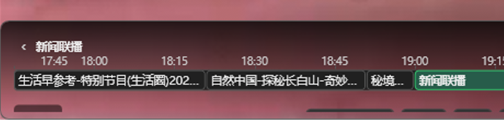
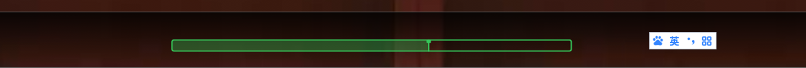

# EPG (Usage and Configuration)

This page explains how to use EPG (Electronic Program Guide) in the player, and how EPG relates to Catchup/Replay and Timeshift.

## What EPG is

EPG is the program schedule. The player uses EPG to get:

- Program time ranges (past/current/future)
- Accurate start/end time for Catchup URL generation

## EPG source

The player supports XMLTV (including `.gz`) EPG URLs. Common ways to provide it:

- **M3U header** `x-tvg-url`:

```m3u
#EXTM3U x-tvg-url="http://example.com/e.xml"
```

- **Player Settings** (useful if M3U does not provide it, or you want to override it)

## Matching Channels to EPG (Matching Priority)

The player uses **chain multi-level matching** strategy, trying in this order:

### Matching Priority (High to Low)

1. **tvg-id Exact Match** — Directly matches M3U `tvg-id` with EPG XML `channel@id`
2. **tvg-id Cleaned Match** — Matches after removing special characters like `-`, `_`, spaces (e.g., `CCTV-1` matches `CCTV1`)
3. **tvg-name Cleaned Match** — Matches M3U `tvg-name` with EPG `display-name` after normalization
4. **channelName Cleaned Match** — Matches M3U channel name (`display-name`) with EPG `display-name` after normalization
5. **Smart Fuzzy Match (Fallback)** — Handles common naming variations like CCTV/TV Station aliases

### M3U Attributes

```m3u
#EXTINF:-1 tvg-id="cctv1" tvg-name="CCTV" group-title="CCTV" ch-name="CCTV-1",http://example.com/stream
```

| Attribute | Description |
|-----------|-------------|
| `tvg-id` | Unique channel identifier for precise matching |
| `tvg-name` | Channel name identifier (independent of display name) |
| `ch-name` or after comma | Channel display name |

### Recommendations

- Fill correct `tvg-id` in your M3U whenever possible (most accurate matching method)
- Also fill `tvg-name` to improve matching success rate
- Keep channel display names close to or consistent with EPG canonical names

## In-player actions (viewing EPG)

1. Play a channel.
2. Open the EPG panel (program list).
3. Switch the date to view schedules for different days.
4. The list shows program status based on current time; the right side uses chip-style badges:
   - Live: red-filled chip; clickable to play the current channel live
   - Replay: green-filled chip; click the program title to generate a replay URL via template and play
   - Reminder: shows a “Reminder” button (same size/rounded corners as chips); appears only for future programs and supports “remind-only / auto-play”
   - Currently Playing: the entire row is highlighted; when replaying, a green left stripe is shown for better visibility

## EPG Timeline (the seek bar)

The progress bar at the bottom of the player window and in the fullscreen overlay is an **EPG timeline** by default: instead of a bare slider it draws the current channel's schedule as a timeline of programme blocks.




### Elements

| Element | Description |
|------|------|
| Programme block | One block per programme, width proportional to its duration; long titles are truncated (hover for the full name) and the programme on air is filled up to the played position |
| Ruler | The top row of time ticks; click anywhere to jump to that time, hover to see the time and the programme under the pointer |
| Badges | `Live` follows the live edge, `Replay` is a past programme you can start, `Timeshift` falls inside the current buffer window, `Reminder` is a future programme |
| Playhead | The current playback position; while timeshifting the live edge is marked as well |
| Paging | The ◀ / ▶ buttons at both ends page by programme; they only move the browsed window and never skip playback |

### Actions

| Action | Result |
|------|------|
| Click a past programme | Jumps to the start of that programme (catchup re-requests the replay URL, timeshift seeks inside the current session) |
| Click a future programme | Same as the “Reminder” button in the guide — books a reminder (notify only / auto play) |
| Click anywhere on the ruler | Jumps to that time; ignored when neither catchup nor timeshift is available |
| Drag the playhead | Continuous seeking; while timeshifting it is clamped to the current buffer window, so no request is made for a time that has not been buffered yet |
| Hover the timeline | Shows a dashed cursor and a bubble (time + programme + hint) |

### Switching to the standard seek bar

Settings → **Playback** → **Seek bar style**:

- **EPG timeline** (default): the programme-aware bar described above
- **Standard seek bar**: only a bar with the played/total time, no programme names or ticks — handy in narrow windows or when programme info is not needed



> When a channel has no EPG, the window bar falls back to the standard seek bar automatically.

## Relationship with Catchup / Timeshift

### Catchup

- Catchup is EPG-driven: when you click a past program, the player uses that program’s start/end time to replace placeholders in `catchup-source` (or global templates).

### Timeshift

- Timeshift range and cursor time can be limited by the earliest available EPG program.
- If the cursor time falls into a known program, the player prefers using that program end time as the replay end time; otherwise it falls back to a default duration.

## FAQ

- **Channel plays but has no EPG**: check `tvg-id` matching and whether the EPG URL is accessible.
- **Catchup time is incorrect**: usually a timezone mismatch (UTC vs local) or source-side format requirement. See [Catchup & Timeshift](./catchup-timeshift).
