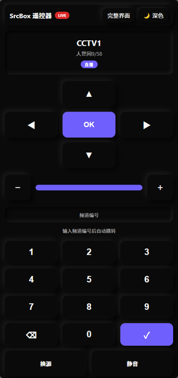
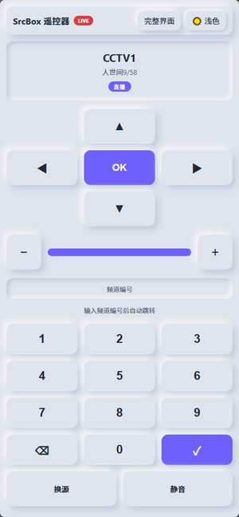
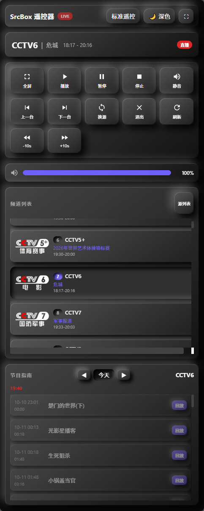
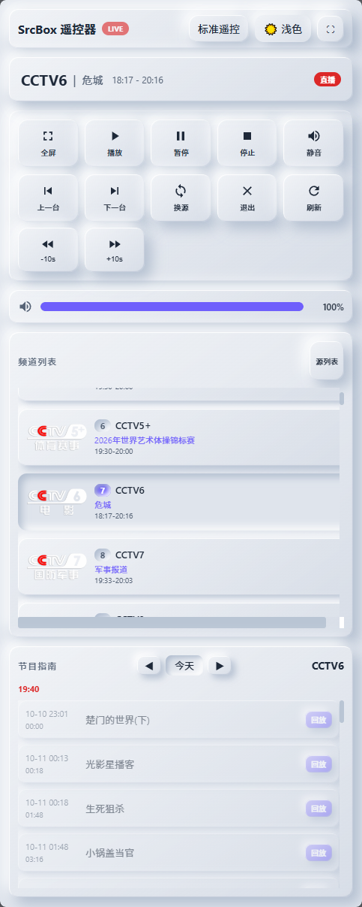
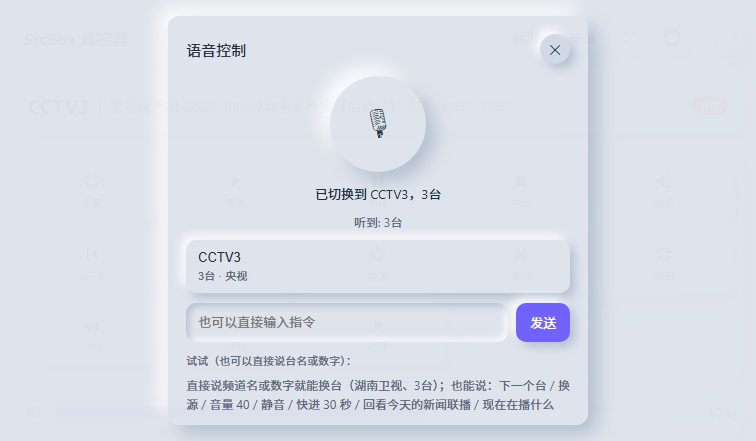

# Web 远程控制

SrcBox 提供 Web 远程控制功能，允许您通过浏览器远程操控播放器，实现播放控制、音量调节、频道切换、回看、预约录制等完整操作。

## 功能概述

Web 远程控制基于 WebSocket 和 HTTP 协议实现，支持以下功能：

- **播放控制**：播放、暂停、停止
- **进度控制**：快进、快退、跳转
- **音量调节**：音量增减、静音
- **频道切换**：上下换台、频道列表、频道搜索
- **回看功能**：时移回看、节目回看
- **预约功能**：预约提醒、预约录制（前台/后台）
- **源管理**：添加、选择、删除播放源
- **状态查看**：当前播放状态、节目信息、EPG节目单
- **多语言支持**：中文、英文、俄文、繁体中文
- **界面切换**：标准遥控界面与完整界面一键切换，选择自动记忆
- **数字键换台**：标准遥控界面可直接输入频道编号换台，频道列表同步显示编号
- **扫码访问**：设置中展示访问二维码与链接，手机扫码或复制链接即可打开
- **HTTPS 访问**：同一个端口同时支持 http 与 https，内置自签证书下载，手机可装成受信任证书
- **安装到主屏幕**：作为 PWA 安装到手机主屏幕，以独立窗口全屏打开

## 启用远程控制

1. 打开 SrcBox 设置窗口
2. 切换到 **Web 远程控制** 选项卡（设置中已独立为一个选项卡）
3. 勾选 **启用 Web 远程控制**，勾选后立即生效，无需重启
4. （可选）设置访问端口（默认 8899）
5. （可选）启用密码保护，设置访问密码
6. 点击 **保存** 按钮

## 访问远程控制

启用后，在浏览器中访问：

```
http://localhost:8899
```

如果是本机访问，直接使用 `localhost`。如果是局域网远程访问，请将 `localhost` 替换为 SrcBox 所在电脑的 IP 地址，例如：

```
http://192.168.1.100:8899
```

同一个端口也支持 HTTPS（服务端按首个字节自动区分），装上证书后可直接访问 `https://192.168.1.100:8899`，详见下方 [HTTPS 与证书](#https-与证书)。

### 扫码访问

启用后，设置窗口的 **Web 远程控制** 选项卡会显示当前访问地址与二维码：

- 用手机相机或浏览器扫描二维码即可打开遥控器
- 点击 **复制链接** 复制访问地址
- 证书就绪时，二维码与链接指向的是 **HTTPS 地址**（`https://电脑IP:端口`，手机首次打开需先安装证书）；证书不可用时才回退为 HTTP 地址
- 选项卡同时显示**证书安装地址**、证书状态（含到期日）与**重新生成证书**按钮
- 二维码与链接会随端口变化自动更新；若未找到局域网地址，请检查网络连接

### HTTPS 与证书

Web 远程控制使用**单端口**同时提供 HTTP 与 HTTPS：同一个端口既能接受 `http://` 也能接受 `https://` 请求（服务端读取首个字节判断是否为 TLS 握手），因此不需要单独配置 HTTPS 端口。

使用 HTTPS 的原因：

- 浏览器的「安装应用」（PWA）与 Service Worker 只在安全上下文（`https://` 或 `localhost`）下可用，手机以 `http://192.168.x.x` 打开时无法把遥控器安装成应用
- 局域网内明文 HTTP 的流量可被同网段设备监听，HTTPS 会加密流量

首次启用远程控制时，SrcBox 会在 `%LOCALAPPDATA%\SrcBox\webremote-certs` 下**自动生成**自签根证书与服务器证书（根证书有效期 10 年；服务器证书 397 天，并在到期前 30 天自动续签），无需手动创建。

用手机以 `http://192.168.1.100:8899` 打开页面后，页面上的 **安装** 按钮会提示当前是 http 明文环境，并给出证书下载入口：

| 地址 | 下载文件 | 用途 |
|:---|:---|:---|
| `/cert` | `srcbox-ca.crt`（DER） | Android、Windows 安装为受信任的 CA 证书 |
| `/cert.pem` | `srcbox-ca.pem` | Android 读不到 `.crt` 时的文本格式备用 |
| `/cert.mobileconfig` | `srcbox-ca.mobileconfig` | iPhone 描述文件，一键安装 |

**Android 安装证书**：设置 → 安全 → 加密与凭据 → 安装证书 → CA 证书 → 选择下载的 `srcbox-ca.crt`（读不到就改用 `.pem`）。

**iOS 安装证书**：安装下载的描述文件后，还需前往 设置 → 通用 → 关于本机 → 证书信任设置，为 SrcBox 证书打开**完全信任**。

装好证书后回到提示框点击 **用 HTTPS 打开**（即跳转到 `https://192.168.1.100:8899/`），也可以在浏览器地址栏直接改用 `https://` 访问。

不想装证书也没关系：Android 用浏览器菜单 →「添加到主屏幕」，打开后点页面右上角的全屏按钮（⛶）；iOS 用 Safari 分享 →「添加到主屏幕」，系统会以全屏方式打开（iOS 不要求证书）。区别只是这种方式不算真正的 PWA 安装。

**卸载证书**：iPhone 在「设置 → 通用 → VPN 与设备管理」移除 SrcBox 描述文件，再到「证书信任设置」关闭完全信任；Android 在「设置 → 安全 → 加密与凭据 → 受信任的凭据 → 用户」中选择 SrcBox 证书移除；Windows 在 `certmgr.msc` 的「受信任的根证书颁发机构 → 证书」中删除 SrcBox。卸载后需改用 `http://` 访问，或重新安装证书。设置页的**重新生成证书**会签发一套新的根证书与服务器证书，旧证书随即失效，手机上需要重新安装。

### HTTPS 可用性与证书续签

- **启动自检**：SrcBox 启动时会用环回地址对自身做一次 TLS 握手自检，只有确认真的能提供 HTTPS，才会在页面与二维码里给出 `https://` 地址。如果当前环境用不了 HTTPS（例如程序受安全策略限制、证书目录不可写），页面与二维码会自动回落到 `http://`，证书下载入口（`/cert`、`/cert.pem`、`/cert.mobileconfig`）仍然可用——不会再给手机一个**打不开的** `https://` 入口。
- **换网后自动续签**：服务器证书会把当前网卡地址写进证书的 SAN。IP 变化（DHCP 续租、切换 Wi-Fi 或网线）后，SrcBox 会按新的地址名单**自动重新签发**服务器证书，不需要重启程序，手机也不会再报 `ERR_CERT_COMMON_NAME_INVALID`；根证书不变，已安装的 CA 不需要重装。
- **想用语音遥控请走 HTTPS**：手机麦克风只在安全上下文（`https://` 或 `localhost`）下可用。以 `http://192.168.x.x` 打开时页面会提示当前不是安全上下文，语音面板无法录音；按上面的步骤装好证书、改用 `https://` 打开即可。

### 安装到主屏幕（PWA）

遥控器页面是一个 PWA（`manifest.json` + Service Worker），可以安装到手机主屏幕，像应用一样全屏打开：

- **Android（Chrome / Edge）**：在安全上下文（https 或 localhost）下页面会显示 **安装** 按钮，点按后选择「安装应用」；若浏览器没有提供安装提示，可打开浏览器菜单 →「安装应用」或「添加到主屏幕」
- **iOS（Safari）**：点「分享」→「添加到主屏幕」，这是 iOS 唯一的安装方式
- 已以独立窗口（standalone）打开时安装入口不再显示；选择过「不再提示」后也不会再出现
- 安装后以独立窗口运行，没有地址栏；页面右上角的全屏按钮（⛶）在纯 http 下同样可用

## 界面截图

| 标准遥控 · 深色 | 标准遥控 · 浅色 |
|:---:|:---:|
|  |  |
| **完整界面 · 深色** | **完整界面 · 浅色** |
|  |  |

## 界面说明

页面右上角的按钮可在两种界面之间切换，选择会记录在浏览器本地：

- **标准遥控**：手机竖屏友好的遥控器布局（方向键、数字键、音量键、换源/静音）
- **完整界面**：状态显示、播放控制、频道列表、EPG、源管理等完整页面（默认）

### 标准遥控界面

| 按钮 | 功能 |
|------|------|
| ▲ 上一频道 | 切换到上一个频道 |
| ▼ 下一频道 | 切换到下一个频道 |
| ◀ 上一源 | 切换到上一个源 |
| ▶ 下一源 | 切换到下一个源 |
| OK | 播放 / 暂停切换 |
| 音量 − / 音量 + | 音量减少 / 增加 5 |
| 数字键 0-9 | 输入频道编号，最多 3 位，停止输入 1.2 秒后自动跳转 |
| ⌫ | 清除已输入的编号 |
| ✓ | 立即跳转到输入的频道 |
| 换源 / 静音 | 切换播放源 / 切换静音状态 |
| 全屏 / 关闭 | 切换全屏 / 关闭播放器 |

界面采用拟物（Neumorphism）风格：默认浅色，使用右上角的 🌙 / ☀️ 按钮可切换深色拟物风格。

### 状态显示区

- 当前播放模式（直播/回看/时移/录制/已停止）
- 当前频道名称和 Logo
- 当前节目名称和播放时间

### 播放控制区

| 按钮 | 功能 |
|------|------|
| 全屏 | 切换全屏模式 |
| 播放 | 开始播放 |
| 暂停 | 暂停播放 |
| 停止 | 停止播放 |
| 静音 | 切换静音状态 |
| 上一频道 | 切换到上一个频道 |
| 下一频道 | 切换到下一个频道 |
| 切换源 | 切换播放源 |
| 退出 | 关闭播放器 |
| 刷新 | 刷新状态数据 |

### 快捷控制区

| 按钮 | 功能 |
|------|------|
| 时移开关 | 开启/关闭当前频道的时移模式 |
| -10s | 快退 10 秒 |
| +10s | 快进 10 秒 |

时移开关点击后会在当前频道开启或关闭时移模式（对应客户端动作 `setTimeshift`），按钮状态跟随播放器回传的 `status.timeshiftEnabled`。

### 音量控制区

- 音量滑块：调节音量大小
- 静音按钮：切换静音状态

### 频道列表

- 显示所有可用频道和收藏频道
- 点击频道名称即可切换播放
- 收藏频道以星标显示在列表顶部
- 每个频道显示频道编号，编号按播放列表的分组顺序连续排列、不随分组重置，与标准遥控界面的数字键一一对应（收藏频道沿用其分组中的编号）

### EPG 节目单

- 显示当前频道的节目列表（默认显示当天节目）
- 点击节目可进入回看
- 支持三个操作按钮：
  - **观看**（红色）：立即切到该频道观看正在直播的节目
  - **回看**（紫色）：仅对**已播出**的节目、且该频道支持回看（`catchup-source`）或时移时显示
  - **预约**（蓝色）：预约节目提醒

### 节目单 Badge 说明

| Badge | 颜色 | 含义 |
|-------|------|------|
| LIVE | 红色 | 正在直播 |
| 回看 | 紫色 | 当前正在回看 |
| 预约 | 蓝色 | 已设置预约提醒 |

### 语音遥控（离线）

页面上的**麦克风按钮**会打开「语音控制」面板：



- 点大麦克风按钮开始说话，再点一次结束；**录音在手机上完成**（16 kHz 单声道），分片上传给播放器
- 播放器用**本机离线模型**（SenseVoice-Small，int8 量化，约 228 MB，**不联网**）识别，音频与识别结果都不会离开本机
- 识别结果与候选频道会回显在面板里（例如听到「3 台」，面板列出 `CCTV3`）；识别完成后面板保持打开，可以连续下达多条指令
- 面板下方的输入框可以直接**输入指令**再点「发送」，效果与语音一致

可以直接说：

| 说法 | 结果 |
|------|------|
| `湖南卫视` / `CCTV3` / `3 台` | 按台名或频道号换台（同音字如「2 太 / 2 胎」也能识别） |
| `下一个台` / `上一个台` | 上下换台 |
| `换源` | 切换当前频道的下一个播放源 |
| `音量 40` / `音量加` / `静音` | 调整音量或静音 |
| `快进 30 秒` / `后退 15 秒` | 相对跳转（回看 / 时移中生效） |
| `回看今天的新闻联播` | 在当前频道的节目单里找到该节目并回看 |
| `现在在播什么` | 播报当前频道的节目信息 |

首次使用只要把 **设置 → Web 遥控器 → 离线语音识别** 打开：开关会先问一句「需要先下载语音模型（约 228 MB），现在下载吗？」，确认后弹出下载窗口，实时显示**阶段（连接 / 下载 / 校验）、百分比、当前文件、速度与剩余时间**，随时可以停止——已下载的部分会保留，下次接着传；每个文件下载完都会与发布值逐一核对 **SHA-256**，然后自动加载模型并跑一段无声样本自检，状态栏显示「语音模型已就绪，自检通过」才真正可用。旁边的**删除模型**按钮会释放磁盘与内存并自动关掉开关。语音唤醒词、自定义短语规则、音量步进也在同一页配置。

> 手机麦克风只在安全上下文（`https://` 或 `localhost`）下可用：以 `http://192.168.x.x` 打开时页面会提示当前不是安全上下文，语音面板无法录音——按上文《HTTPS 与证书》装好证书、改用 `https://` 打开即可。

### 源管理（需展开）

- 显示所有已保存的播放源
- 当前选中的源以高亮显示
- 支持选择、添加、删除源

### 预约管理（需展开）

- 显示所有已设置的预约
- 支持取消预约
- 显示预约频道、节目名称、时间、动作类型

### 录制管理（需展开）

- 显示所有录制任务
- 支持停止正在录制的任务
- 支持删除已完成/失败的录制

## 安全设置

### 密码保护

启用密码保护后，访问远程控制页面需要输入密码：

1. 在设置中勾选 **需要密码访问**
2. 设置访问密码
3. 保存设置

访问时需要输入密码才能使用远程控制功能。

### 注意事项

- 启用后服务监听本机**所有网卡**（`0.0.0.0`），同一局域网内的任何设备只要知道地址和端口即可访问；默认**不开启密码**，建议勾选「需要密码访问」
- 如需局域网访问，请确保防火墙允许对应端口
- 建议启用密码保护以确保安全
- 局域网内明文 `http://` 的流量可被同网段设备监听，建议安装证书后改用 `https://` 访问（见 [HTTPS 与证书](#https-与证书)）
- 手机安装到主屏幕需要安全上下文（https 或 localhost），纯 http 只能「添加到主屏幕」
- 更改端口后需要刷新浏览器页面
- 设置中的 **显示频道列表** 与 **显示节目单** 开关会真正生效：关闭后远程页面不再显示对应区块
- 设置中的 **节目单条数上限**（5–500，默认 50）控制单个频道一次返回的节目数量

## WebSocket API 参考

除了浏览器界面操作外，还可以通过 WebSocket API 进行编程控制。

### 连接方式

```javascript
const ws = new WebSocket('ws://localhost:8899');
```

### 认证（需要密码时）

```json
// 发送
{ "action": "auth", "password": "your_password" }

// 接收
{ "success": true, "requireAuth": true }
```

### 通用响应格式

所有操作成功后返回 JSON 响应，失败返回 `{ "error": "错误信息" }` 或 `{ "success": false }`。

### API 列表

#### 播放控制

| Action | 参数 | 说明 |
|--------|------|------|
| `play` | - | 播放/继续播放 |
| `pause` | - | 暂停播放 |
| `stop` | - | 停止播放 |
| `volume` | `volume` (0-100) | 设置音量 |
| `fullscreen` | - | 切换全屏 |
| `seek` | `seconds` (+/-数值) | 跳转秒数 |

#### 频道控制

| Action | 参数 | 说明 |
|--------|------|------|
| `channel` | `channelId` | 切换频道 |

上一频道 / 下一频道按钮由页面按当前频道列表算出目标频道 id，再调用 `channel` 实现；WebSocket 接口本身没有 `prevChannel` / `nextChannel` 动作（调用会返回 `Unknown action`）。

#### 速度控制

| Action | 参数 | 说明 |
|--------|------|------|
| `setSpeed` | `speed` (0.5/1.0/2.0) | 设置播放倍速 |
| `setTimeshift` | `enabled` (true/false) | 开启/关闭时移 |

#### 回看功能

| Action | 参数 | 说明 |
|--------|------|------|
| `replayProgram` | `channelId`, `programTitle`, `start` (ISO), `end` (ISO) | 回看指定节目（页面上的 **回看** 按钮只在节目已播出、且该频道支持回看或时移时显示） |

#### 状态查询

| Action | 返回 | 说明 |
|--------|------|------|
| `getStatus` | `{ playing, mode, channel, volume, ... }` | 获取播放状态 |
| `getChannels` | `{ groups: [...], favorites: [...] }` | 获取频道列表 |
| `getEpg` | `{ channelId, programs: [...] }` | 获取节目单 |
| `getSources` | `{ sources: [...] }` | 获取播放源列表 |
| `getReminders` | `{ reminders: [...] }` | 获取预约列表 |
| `getRecordings` | `{ recordings: [...] }` | 获取录制列表 |

#### 预约管理

| Action | 参数 | 说明 |
|--------|------|------|
| `addReminder` | `channelId`, `startAt` (ISO), `endTime` (ISO), `action`, `programTitle`, `preAlertSeconds`, `recordDurationMin` | 添加预约 |
| `cancelReminder` | `id` | 取消预约 |

#### 录制管理

| Action | 参数 | 说明 |
|--------|------|------|
| `stopRecording` | `id` | 停止录制 |
| `deleteRecording` | `id` | 删除录制 |

#### 源管理

| Action | 参数 | 说明 |
|--------|------|------|
| `selectSource` | `name` 或 `url` | 选择播放源 |
| `addSource` | `name`, `url` | 添加播放源 |
| `removeSource` | `name` 或 `url` | 删除播放源 |
| `prevSource` | - | 上一个源 |
| `nextSource` | - | 下一个源 |

#### 其他

| Action | 参数 | 说明 |
|--------|------|------|
| `exit` | - | 关闭播放器 |
| `switchSource` | - | 切换源 |

### 返回数据格式

#### getStatus 返回示例

```json
{
  "playing": true,
  "mode": "Replay",
  "modeText": "回看",
  "channel": {
    "id": "CCTV1",
    "name": "CCTV1",
    "logo": "http://..."
  },
  "volume": 70,
  "muted": false,
  "speed": 1.0,
  "currentProgram": {
    "name": "晚间新闻",
    "start": "19:00",
    "end": "19:30",
    "isCurrent": true
  },
  "timeshiftEnabled": true,
  "timeshift": {
    "active": true,
    "cursor": "00:05:30",
    "range": "19:00 - 23:00"
  }
}
```

#### getEpg 返回示例

```json
{
  "channelId": "CCTV1",
  "programs": [
    {
      "name": "新闻联播",
      "start": "19:00",
      "end": "19:30",
      "startISO": "2026-08-16T11:00:00.000Z",
      "endISO": "2026-08-16T11:30:00.000Z",
      "isCurrent": true,
      "badge": "live",
      "badgeHtml": "<span class=\"epg-badge epg-badge-live\">正在播出</span>"
    }
  ]
}
```

## 故障排除

### 无法访问远程控制页面

1. 确认已在设置中启用 Web 远程控制
2. 检查端口是否被占用（默认 8899）
3. 检查防火墙设置
4. 确认 SrcBox 播放器正在运行

### 页面显示空白

1. 尝试刷新页面
2. 清除浏览器缓存
3. 使用其他浏览器访问
4. 检查是否启用了密码保护

### 操作无响应

1. 确认 SrcBox 播放器正在播放
2. 检查网络连接是否正常
3. 尝试重新启动 SrcBox 播放器

## 技术实现

Web 远程控制采用以下技术：

- **WebSocket**：实时双向通信，用于播放控制指令
- **HTTP**：状态查询和静态资源服务
- **JSON**：数据交换格式
- **原生 HTML/CSS/JS**：无外部依赖

服务端默认监听端口 8899，Web 界面通过浏览器访问，无需额外安装软件。
