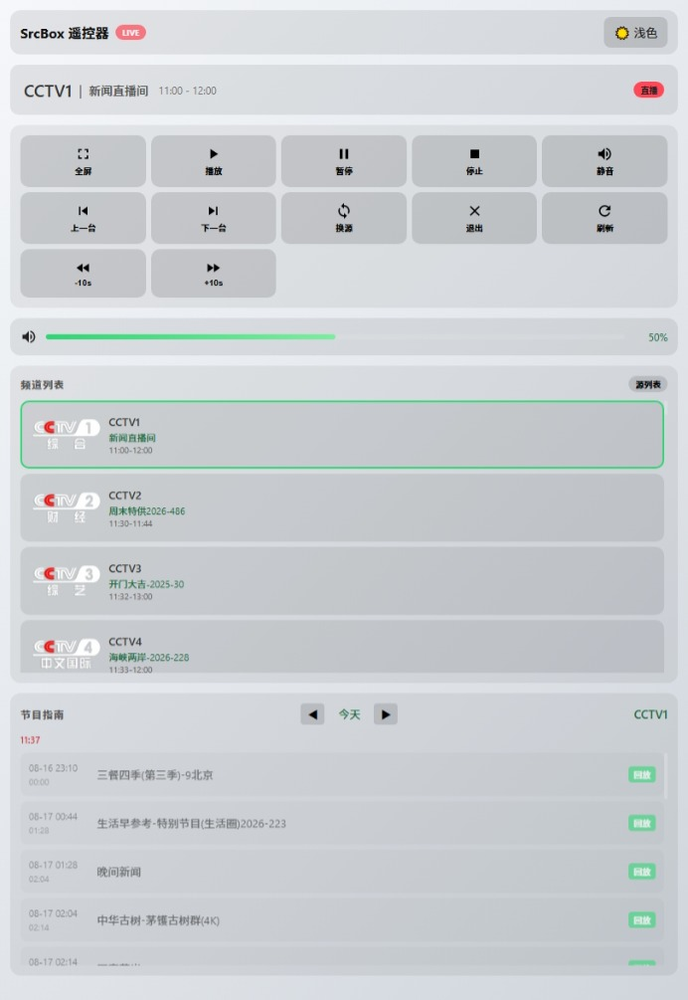

# Web 遠程控制

SrcBox 提供 Web 遠程控制功能，允許您通過瀏覽器遠程操控播放器，實現播放控制、音量調節、頻道切換、回看、預約錄製等完整操作。

## 功能概述

Web 遠程控制基於 WebSocket 和 HTTP 協議實現，支援以下功能：

- **播放控制**：播放、暫停、停止
- **進度控制**：快進、快退、跳轉
- **音量調節**：音量增減、静音
- **頻道切換**：上下換台、頻道列表、頻道搜尋
- **回看功能**：時移回看、節目回看
- **預約功能**：預約提醒、預約錄製（前台/後台）
- **源管理**：添加、選擇、刪除播放源
- **狀態查看**：當前播放狀態、節目信息、EPG節目單
- **多語言支持**：中文、英文、俄文、繁體中文
- **界面切換**：標準遙控界面與完整界面一鍵切換，選擇自動記憶
- **數字鍵換台**：標準遙控界面可直接輸入頻道編號換台，頻道列表同步顯示編號
- **掃碼訪問**：設置中展示訪問二維碼與鏈接，手機掃碼或複製鏈接即可打開

## 啟用遠程控制

1. 打開 SrcBox 設置窗口
2. 切換到 **Web 遠程控制** 選項卡（設置中已獨立為一個選項卡）
3. 勾選 **啟用 Web 遠程控制**，勾選後立即生效，無需重啟
4. （可選）設置訪問端口（默認 8899）
5. （可選）啟用密碼保護，設置訪問密碼
6. 點擊 **保存** 按鈕

## 訪問遠程控制

啟用後，在瀏覽器中訪問：

```
http://localhost:8899
```

如果是本機訪問，直接使用 `localhost`。如果是區域網遠程訪問，請將 `localhost` 替換為 SrcBox 所在電腦的 IP 地址，例如：

```
http://192.168.1.100:8899
```

### 掃碼訪問

啟用後，設置窗口的 **Web 遠程控制** 選項卡會顯示當前訪問地址與二維碼：

- 用手機相機或瀏覽器掃描二維碼即可打開遙控器
- 點擊 **複製鏈接** 複製訪問地址
- 二維碼與鏈接會隨端口變化自動更新；若未找到區域網地址，請檢查網絡連接

## 介面截圖



## 界面說明

頁面右上角的按鈕可在兩種界面之間切換，選擇會記錄在瀏覽器本地：

- **標準遙控**：手機豎屏友好的遙控器佈局（方向鍵、數字鍵、音量鍵、換源/静音）
- **完整界面**：狀態顯示、播放控制、頻道列表、EPG、源管理等完整頁面（默認）

### 標準遙控界面

| 按鈕 | 功能 |
|------|------|
| ▲ 上一頻道 | 切換到上一個頻道 |
| ▼ 下一頻道 | 切換到下一個頻道 |
| ◀ 上一源 | 切換到上一個源 |
| ▶ 下一源 | 切換到下一個源 |
| OK | 播放 / 暫停切換 |
| 音量 − / 音量 + | 音量減少 / 增加 5 |
| 數字鍵 0-9 | 輸入頻道編號，最多 3 位，停止輸入 1.2 秒後自動跳轉 |
| ⌫ | 清除已輸入的編號 |
| ✓ | 立即跳轉到輸入的頻道 |
| 換源 / 静音 | 切換播放源 / 切換静音狀態 |

界面採用擬物（Neumorphism）風格：默認淺色，使用右上角的 🌙 / ☀️ 按鈕可切換深色擬物風格。

### 狀態顯示區

- 當前播放模式（直播/回看/時移/錄製/已停止）
- 當前頻道名稱和 Logo
- 當前節目名稱和播放時間

### 播放控制區

| 按鈕 | 功能 |
|------|------|
| 全屏 | 切換全屏模式 |
| 播放 | 開始播放 |
| 暫停 | 暫停播放 |
| 停止 | 停止播放 |
| 静音 | 切換静音狀態 |
| 上一頻道 | 切換到上一個頻道 |
| 下一頻道 | 切換到下一個頻道 |
| 切換源 | 切換播放源 |
| 退出 | 關閉播放器 |
| 刷新 | 刷新狀態數據 |

### 快捷控制區

| 按鈕 | 功能 |
|------|------|
| 時移開關 | 開啟/關閉時移模式 |
| -10s | 快退 10 秒 |
| +10s | 快進 10 秒 |
| 0.5x | 0.5 倍速播放 |
| 1x | 正常倍速 |
| 2x | 2 倍速播放 |

### 音量控制區

- 音量滑塊：調節音量大小
- 静音按鈕：切換静音狀態

### 頻道列表

- 顯示所有可用頻道和收藏頻道
- 點擊頻道名稱即可切換播放
- 收藏頻道以星標顯示在列表頂部
- 每個頻道顯示頻道編號，編號按播放清單的分組順序連續排列、不隨分組重置，與標準遙控界面的數字鍵一一對應（收藏頻道沿用其分組中的編號）

### EPG 節目單

- 顯示當前頻道的節目列表（默認顯示當天節目）
- 點擊節目可進入回看
- 支援三種操作按鈕：
  - **回看**（紫色）：回看已播出的節目
  - **時移**（藍色）：時移當前節目
  - **預約**（綠色）：預約未來節目提醒
  - **錄製**（橙色）：預約前台錄製

### 節目單 Badge 說明

| Badge | 顏色 | 含義 |
|-------|------|------|
| LIVE | 紅色 | 正在直播 |
| 回看 | 紫色 | 當前正在回看 |
| 預約 | 綠色 | 已設置預約提醒 |
| 下一節目 | 橙色 | 下一個即將播出 |

### 源管理（需展開）

- 顯示所有已保存的播放源
- 顯示源的健康狀態（綠色=正常，紅色=失敗）
- 支援選擇、添加、刪除源

### 預約管理（需展開）

- 顯示所有已設置的預約
- 支援取消預約
- 顯示預約頻道、節目名稱、時間、動作類型

### 錄製管理（需展開）

- 顯示所有錄製任務
- 支援停止正在錄製的任務
- 支援刪除已完成/失敗的錄製

## 安全設置

### 密碼保護

啟用密碼保護後，訪問遠程控制頁面需要輸入密碼：

1. 在設置中勾選 **需要密碼訪問**
2. 設置訪問密碼
3. 保存設置

訪問時需要輸入密碼才能使用遠程控制功能。

### 注意事項

- 默認情況下，遠程控制僅允許本地訪問（localhost）
- 如需區域網訪問，請確保防火牆允許對應端口
- 建議啟用密碼保護以確保安全
- 更改端口後需要刷新瀏覽器頁面

## WebSocket API 參考

除了瀏覽器界面操作外，還可以通過 WebSocket API 進行編程控制。

### 連接方式

```javascript
const ws = new WebSocket('ws://localhost:8899');
```

### 認證（需要密碼時）

```json
// 發送
{ "action": "auth", "password": "your_password" }

// 接收
{ "success": true, "requireAuth": true }
```

### 通用響應格式

所有操作成功後返回 JSON 響應，失敗返回 `{ "error": "錯誤信息" }` 或 `{ "success": false }`。

### API 列表

#### 播放控制

| Action | 參數 | 說明 |
|--------|------|------|
| `play` | - | 播放/繼續播放 |
| `pause` | - | 暫停播放 |
| `stop` | - | 停止播放 |
| `volume` | `volume` (0-100) | 設置音量 |
| `fullscreen` | - | 切換全屏 |
| `seek` | `seconds` (+/-數值) | 跳轉秒數 |

#### 頻道控制

| Action | 參數 | 說明 |
|--------|------|------|
| `channel` | `channelId` | 切換頻道 |
| `prevChannel` | - | 上一個頻道 |
| `nextChannel` | - | 下一個頻道 |

#### 速度控制

| Action | 參數 | 說明 |
|--------|------|------|
| `setSpeed` | `speed` (0.5/1.0/2.0) | 設置播放倍速 |
| `setTimeshift` | `enabled` (true/false) | 開啟/關閉時移 |

#### 回看功能

| Action | 參數 | 說明 |
|--------|------|------|
| `replayProgram` | `channelId`, `programTitle`, `start` (ISO), `end` (ISO) | 回看指定節目 |

#### 狀態查詢

| Action | 返回 | 說明 |
|--------|------|------|
| `getStatus` | `{ playing, mode, channel, volume, ... }` | 獲取播放狀態 |
| `getChannels` | `{ groups: [...], favorites: [...] }` | 獲取頻道列表 |
| `getEpg` | `{ channelId, programs: [...] }` | 獲取節目單 |
| `getSources` | `{ sources: [...] }` | 獲取播放源列表 |
| `getReminders` | `{ reminders: [...] }` | 獲取預約列表 |
| `getRecordings` | `{ recordings: [...] }` | 獲取錄製列表 |

#### 預約管理

| Action | 參數 | 說明 |
|--------|------|------|
| `addReminder` | `channelId`, `startAt` (ISO), `endTime` (ISO), `action`, `programTitle`, `preAlertSeconds`, `recordDurationMin` | 添加預約 |
| `cancelReminder` | `id` | 取消預約 |

#### 錄製管理

| Action | 參數 | 說明 |
|--------|------|------|
| `stopRecording` | `id` | 停止錄製 |
| `deleteRecording` | `id` | 刪除錄製 |

#### 源管理

| Action | 參數 | 說明 |
|--------|------|------|
| `selectSource` | `name` 或 `url` | 選擇播放源 |
| `addSource` | `name`, `url` | 添加播放源 |
| `removeSource` | `name` 或 `url` | 刪除播放源 |
| `prevSource` | - | 上一個源 |
| `nextSource` | - | 下一個源 |

#### 其他

| Action | 參數 | 說明 |
|--------|------|------|
| `exit` | - | 關閉播放器 |
| `switchSource` | - | 切換源 |

### 返回數據格式

#### getStatus 返回示例

```json
{
  "playing": true,
  "mode": "Replay",
  "modeText": "回看",
  "channel": {
    "id": "CCTV1",
    "name": "CCTV1",
    "logo": "http://..."
  },
  "volume": 70,
  "muted": false,
  "speed": 1.0,
  "currentProgram": {
    "name": "晚間新聞",
    "start": "19:00",
    "end": "19:30",
    "isCurrent": true
  },
  "timeshiftEnabled": true,
  "timeshift": {
    "active": true,
    "cursor": "00:05:30",
    "range": "19:00 - 23:00"
  }
}
```

#### getEpg 返回示例

```json
{
  "channelId": "CCTV1",
  "programs": [
    {
      "name": "新聞聯播",
      "start": "19:00",
      "end": "19:30",
      "startISO": "2026-08-16T11:00:00.000Z",
      "endISO": "2026-08-16T11:30:00.000Z",
      "isCurrent": true,
      "badge": "live",
      "badgeHtml": "<span class=\"epg-badge epg-badge-live\">正在播出</span>"
    }
  ]
}
```

## 故障排除

### 無法訪問遠程控制頁面

1. 確認已在設置中啟用 Web 遠程控制
2. 檢查端口是否被占用（默認 8899）
3. 檢查防火牆設置
4. 確認 SrcBox 播放器正在運行

### 頁面顯示空白

1. 嘗試刷新頁面
2. 清除瀏覽器緩存
3. 使用其他瀏覽器訪問
4. 檢查是否啟用了密碼保護

### 操作無響應

1. 確認 SrcBox 播放器正在播放
2. 檢查網絡連接是否正常
3. 嘗試重新啟動 SrcBox 播放器

## 技術實現

Web 遠程控制採用以下技術：

- **WebSocket**：實時雙向通信，用於播放控制指令
- **HTTP**：狀態查詢和靜態資源服務
- **JSON**：數據交換格式
- **原生 HTML/CSS/JS**：無外部依賴

服務端默認監聽端口 8899，Web 界面通過瀏覽器訪問，無需額外安裝軟體。
